<div align="center">



# 🛡️ Awesome Audit Management 📊

[](https://awesome.re)
[](https://opensource.org/licenses/MIT)
[](http://makeapullrequest.com)
[](https://github.com/ishandutta2007)

**A curated index of top-tier enterprise SaaS and open-source Audit Management, Governance, Risk, and Compliance (GRC), and Internal Controls software.**

</div>

---

## 📑 Table of Contents
- [🔍 Sector Overview & Market Dynamics](#-sector-overview--market-dynamics)
- [💼 Enterprise SaaS Solutions](#-enterprise-saas-solutions)
  - [🏢 Enterprise Comparison Matrix](#-enterprise-comparison-matrix)
  - [🔬 Detailed SaaS Profiles](#-detailed-saas-profiles)
- [💻 Open-Source & Self-Hosted Solutions](#-open-source--self-hosted-solutions)
- [🎯 Selection Guide: SaaS vs. Open-Source](#-selection-guide-saas-vs-open-source)
- [🤝 Contributing](#-contributing)
- [📄 License](#-license)

---

## 🔍 Sector Overview & Market Dynamics

The global **Audit Management Software** market is valued at approximately **$1.41 billion to $1.67 billion (2024–2025)** and is projected to expand at a compound annual growth rate (CAGR) of 11.2% to 13.5% through 2030, accelerated by stringent cross-border regulations (such as SOX 404, CSRD, DORA, and ISO 27001) alongside AI-driven audit automation.

The sector demonstrates **moderate fragmentation with strong enterprise concentration at the upper tier**: massive platform ecosystems (such as ServiceNow and Archer) dominate multi-billion-dollar global enterprises through deep CMDB and ERP coupling, while agile cloud-native challengers (like AuditBoard, Vanta, and Workiva) capture high-growth mid-market and specialized compliance audit segments rather than a single winner-take-all monopoly.

---

## 💼 Enterprise SaaS Solutions

### 🏢 Enterprise Comparison Matrix

> [!NOTE]
> The table below is sorted in descending order by **Company Size (Revenue / Valuation)** to reflect market presence and operational scale.

| Product / Company 🏷️ | Company Size (Revenue / Valuation) 🏛️ | Pricing 💳 | Free Tier / Trial Limits ⏳ | Key Focus & Use Cases 🎯 |
| :--- | :--- | :--- | :--- | :--- |
| **[ServiceNow Audit Management](https://www.servicenow.com/products/audit-management.html)** | **~$164B Mkt Cap** / ~$13.3B ARR | **$40,000/year base package** *(typical GRC/IRM fulfills at ~$100–$140/fulfiller user/month; contracts scale $40K–$100K+ annually)* | **15-Day Personal Developer Instance (PDI)** / guided corporate sandbox demo (single-tenant test sandbox; expires after 10 days of inactivity) | Enterprise Integrated Risk Management (IRM), CMDB-integrated audit evidence collection, continuous IT control monitoring |
| **[Workiva](https://www.workiva.com/solutions/internal-audit-management)** | **~$4.6B Mkt Cap** / ~$1.0B ARR | **$25,000/year starting tier** *(Vendr median: ~$60,000/year; large SEC/ESG setups exceed $150K/year)* | **No free tier**; **14-Day guided proof-of-concept (PoC)** trial upon qualified enterprise sales consultation (includes sample workspace & 5 test collaborators) | Connected internal audit, SEC reporting, ESG assurance data-linking, SOX controls testing & narrative generation |
| **[AuditBoard](https://www.auditboard.com/)** | **$3.0B+ Valuation** *(Acquired by Hg Capital; >$200M ARR)* | **$30,000/year base tier** *(standard OpsAudit & SOX bundles average $30K–$50K/year; enterprise tiers reach $150K+/year)* | **No free tier**; **14-Day sandbox trial** available exclusively through enterprise account execs (pre-seeded with standard SOX & operational audit templates) | Purpose-built internal audit (OpsAudit), SOX 404 compliance (SOXHub), risk registers (RiskOversight), and ESG metrics |
| **[Vanta](https://www.vanta.com/)** | **$2.45B Valuation** *(Series C; ~$100M+ ARR)* | **$7,500/year starting tier** *(Core framework package; median contracts range $12,000–$32,000/year based on employee count)* | **No free tier**; **14-Day guided trial** with full automated evidence collector integrations (supports up to 25 cloud service connections) | Continuous compliance automation, automated evidence gathering for SOC 2, ISO 27001, HIPAA, and GDPR |
| **[Archer GRC](https://www.archerirm.com/)** | **$2.0B+ Valuation** *(Acquired by Cinven; ~$220M ARR)* | **$18,000/year base package** *(Per-user licenses list on CDW from ~$60/user/month; enterprise deployment packages range $75K–$250K+ annually)* | **No free tier**; **30-Day guided enterprise evaluation license** (on-premise ova appliance or hosted cloud instance limited to 5 named admin users) | Heavyweight enterprise integrated risk management, third-party governance, IT security assurance, and regulatory reporting |
| **[SafetyCulture](https://safetyculture.com/)** | **$2.5B Valuation** *(~AU$2.5B; ~$100M ARR)* | **$24/user/month** *(billed annually; $29/user billed monthly for Premium tier)* | **Free-forever plan: Up to 10 users**, strictly capped at **5 active inspection templates**, 3-year data retention, basic reporting | Mobile-first workplace safety inspections, frontline field audits, operational checklist compliance, and incident resolution |
| **[MetricStream](https://www.metricstream.com/solutions/internal-audit-management.html)** | **~$120M Annual Revenue** *(Private equity backed)* | **$75,000/year base package** *(Modular licensing; enterprise multi-business-unit setups scale $150,000–$500,000+ per year)* | **No free tier**; **30-Day guided proof-of-value (PoV)** sandbox (limited to 1 business unit, 10 named user accounts, and 2 standard audit universes) | Global enterprise internal audit management, risk-based audit planning, issue remediation tracking, and executive board reporting |
| **[Sprinto](https://sprinto.com/)** | **$150M+ Valuation** *(Series B; ~$15M ARR)* | **$7,500/year starter tier** *(AWS Marketplace listed for teams under 100 employees; median contracts range $12,000–$18,000/year)* | **No free tier**; **14-Day guided interactive trial** (pre-configured security controls catalog, test evidence collectors for AWS/GitHub) | Fast-growing tech companies, automated security control checks, continuous audit readiness for SOC 2, ISO 27001, and PCI-DSS |

---

### 🔬 Detailed SaaS Profiles

#### 1. ServiceNow Audit Management
- **Overview:** Integrates directly into the Now Platform CMDB, allowing internal audit teams to run end-to-end audit lifecycles while pulling evidence automatically from live IT and business workflows.
- **Ideal For:** Large enterprises already committed to ServiceNow ITSM or SecOps seeking continuous IT and operational controls audit.

#### 2. Workiva
- **Overview:** Industry-leading connected reporting and compliance platform that links narrative reports directly to raw financial and operational data sources.
- **Ideal For:** Publicly traded companies with complex SOX, internal audit, SEC 10-K/10-Q, and ESG regulatory reporting requirements.

#### 3. AuditBoard
- **Overview:** Cloud-native software built specifically by auditors for auditors, uniting operational audit management, SOX compliance, vendor risk, and controls testing into an intuitive dashboard.
- **Ideal For:** Mid-market to enterprise internal audit teams looking for seamless fieldwork collaboration, workpaper management, and committee reporting.

#### 4. Vanta
- **Overview:** Pioneered compliance automation by continuously ingesting API signals across cloud infrastructure (AWS, GCP, Azure), identity providers, and HRIS tools.
- **Ideal For:** Startups, scale-ups, and modern tech enterprises preparing for SOC 2 Type I/II, ISO 27001, and HIPAA audits in weeks instead of months.

#### 5. Archer GRC
- **Overview:** Pioneer in enterprise Integrated Risk Management (IRM) that offers battle-tested modules for operational risk, audit planning, and third-party vendor risk.
- **Ideal For:** Heavily regulated financial institutions, healthcare networks, and defense contractors with legacy on-premises or multi-cloud infrastructures.

#### 6. SafetyCulture (iAuditor)
- **Overview:** Leading mobile operations and inspection platform empowering frontline teams to complete audits, document hazards, and log corrective actions in real time.
- **Ideal For:** Manufacturing, construction, retail, logistics, and hospitality businesses requiring rigorous field and safety audits.

#### 7. MetricStream
- **Overview:** Highly customizable enterprise governance platform tailored for large international conglomerates needing federated internal audit planning across disparate subsidiaries.
- **Ideal For:** Global conglomerates managing distributed internal audit teams and thousands of annual regulatory controls.

#### 8. Sprinto
- **Overview:** Modern compliance orchestration platform that automates evidence collection, maps security controls to risk matrices, and simplifies auditor handoffs.
- **Ideal For:** B2B SaaS organizations seeking turnkey compliance automation with human-assisted audit support.

---

## 💻 Open-Source & Self-Hosted Solutions

Open-source audit and compliance platforms give privacy-conscious security teams, internal auditors, and engineering groups total data sovereignty, zero recurring seat costs, and direct database inspection.

> [!TIP]
> The table below is sorted in descending order by **GitHub Star Count**. Star badges link directly to each project's stargazers page!

| Project 🛠️ | Popularity ⭐ | License 📜 | Technology Stack ⚙️ | Description & Audit Capabilities 📝 |
| :--- | :--- | :--- | :--- | :--- |
| **[DefectDojo](https://github.com/DefectDojo/django-DefectDojo)** | [](https://github.com/DefectDojo/django-DefectDojo/stargazers) | BSD-3-Clause | Python, Django, Celery | Leading open-source vulnerability management and security audit orchestrator; standardizes reports from 160+ security tools into unified audit workpapers. |
| **[CISO Assistant Community](https://github.com/intuitem/ciso-assistant-community)** | [](https://github.com/intuitem/ciso-assistant-community/stargazers) | AGPL-3.0 | Python, Django, React | Modern one-stop-shop GRC platform with 200+ global framework mappings (ISO 27001, NIST CSF, SOC 2, PCI DSS, NIS2, DORA, GDPR, HIPAA) with control testing and internal audit tracking. |
| **[StrongDM Comply](https://github.com/strongdm/comply)** | [](https://github.com/strongdm/comply/stargazers) | Apache-2.0 | Go, Hugo | SOC 2-focused compliance automation CLI and internal audit framework; converts internal policy markdown files into audit-ready documentation and checklists. |
| **[Probo](https://github.com/getprobo/probo)** | [](https://github.com/getprobo/probo/stargazers) | AGPL-3.0 | Go, TypeScript, React | Open-source alternative to Vanta and Drata; manages compliance postures, automated evidence collection, risk evaluations, and audits for SOC 2, ISO 27001, and GDPR. |
| **[Awesome Security GRC](https://github.com/GRC-Engineer/awesome-security-GRC)** | [](https://github.com/GRC-Engineer/awesome-security-GRC/stargazers) | CC0-1.0 | Markdown | Comprehensive curated knowledge repository featuring audit programs, compliance matrices, risk assessment methodologies, and practitioner guides. |
| **[GApps Compliance](https://github.com/bmarsh9/gapps)** | [](https://github.com/bmarsh9/gapps/stargazers) | MIT | Python, Flask, SQLite | Self-hosted security compliance tracker for SOC 2, NIST CSF, NIST 800-53, ISO 27001, HIPAA, and CIS 18; simplifies milestone audits and control validation. |
| **[SimpleRisk](https://github.com/simplerisk/code)** | [](https://github.com/simplerisk/code/stargazers) | LGPL-3.0 | PHP, MySQL, Docker | Established open-source risk management platform supporting risk assessments, audit planning, control gap analyses, and compliance tracking. |
| **[Eramba Docker](https://github.com/eramba/docker)** | [](https://github.com/eramba/docker/stargazers) | Eramba Community | PHP, MySQL, Docker | Dedicated Docker packaging for Eramba Community Edition; provides internal control testing, policy lifecycles, risk reviews, and audit compliance logging. |
| **[Awesome Internal Audit](https://github.com/NajiElKotob/Awesome-InternalAudit)** | [](https://github.com/NajiElKotob/Awesome-InternalAudit/stargazers) | MIT | Markdown | Curated directory of computer-aided audit tools (CAATs), IIA standards references, continuous auditing algorithms, and working paper resources. |
| **[AuditSym](https://github.com/SUALBA/AuditSym)** | [](https://github.com/SUALBA/AuditSym/stargazers) | Apache-2.0 | TypeScript, React, Python | Privacy-first, local-first GRC & audit co-pilot with local RAG evidence extraction and remediation tracking across NIST CSF 2.0, ISO 27001, and CIS Controls v8. |

---

## 🎯 Selection Guide: SaaS vs. Open-Source

```
                           What is your primary audit requirement?
                                              │
               ┌──────────────────────────────┴──────────────────────────────┐
               ▼                                                             ▼
     Regulatory / Continuous Cloud GRC                              Internal Field & Enterprise Audit
               │                                                             │
        Budget Available?                                            Integration Scope?
        ┌──────┴──────┐                                              ┌──────┴──────┐
        ▼             ▼                                              ▼             ▼
      Under $10K    $25K - $100K+                              ServiceNow Native  Dedicated Internal Audit
        │             │                                              │             │
        ▼             ▼                                              ▼             ▼
    Probo /       Vanta / Sprinto                             ServiceNow IRM   AuditBoard / Workiva
   CISO Assistant
```

- **Choose Enterprise SaaS** if you require out-of-the-box auditor portal sharing, automated API connectors to cloud services (AWS, Google Workspace, Azure AD), dedicated customer success teams, and pre-packaged SOC 2 / ISO 27001 audit workflows.
- **Choose Open-Source** if your organization operates in air-gapped environments, handles confidential IP where data cannot leave your VPC, requires custom data schema extensions, or wants zero ongoing seat licensing fees.

---

## 🤝 Contributing

Contributions are warmly welcomed! Please read our guidelines before submitting:
1. 🍴 Fork the repository.
2. 🌿 Create a descriptive feature branch (`git checkout -b feature/add-new-audit-tool`).
3. ✍️ Add the tool in alphabetical or sorted order with exact pricing/star counts.
4. 📬 Open a Pull Request with details on why the tool should be included.

---

## 📄 License

This repository and curated list are released under the [MIT License](LICENSE).
